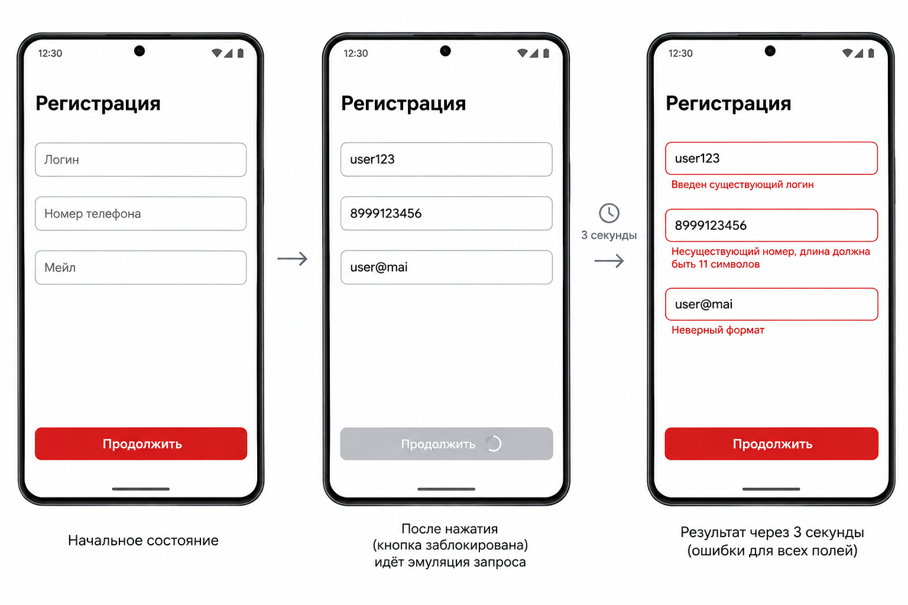

# Задание в Альфа Банк — лайвкод в IDE

## Наполнение экрана:

- Toolbar “Регистрация”
- Логин
- Номер телефона
- Мейл
- Кнопка "Продолжить" внизу экрана

**Логика.** По нажатию на кнопку происходит эмуляция работы бэкенда - через 3 секунды приходят ошибки для полей ввода всегда

Ошибки:

- Для логина - введен существующий логин
- Для номера телефона - 1) несуществующий номер 2) длина должна быть 11 символов
- Для Мейла - неверный формат

Все ошибки должны выводиться под инпутом, красным цветом.

Если Больше 1, то отображаем через запятую, в строку

Если мы нажимаем продолжить, то кнопка дизейблится и все ошибки инвалидируются

## Примерные макеты:

